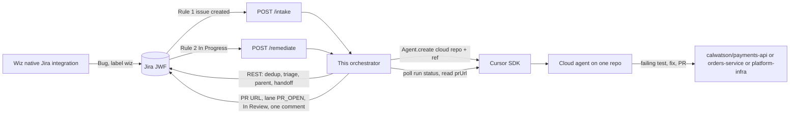

# Wiz security factory, Cursor SDK edition

SYNTHETIC DEMO. Tickets, cloud accounts, package findings, and secrets in `data/` are fake. They were copied from the Wiz → Jira agentic security factory kit. Nothing here is a customer report. `.env.example` contains placeholders only.

The Automations kit sends Jira webhooks to Cursor Automations, and those agents read and write Jira through a Jira MCP server. This repo replaces that with a small Node 22 service. The service owns Jira. It launches one Cursor cloud agent per correlation group through `@cursor/sdk`, then writes the pull request back to Jira itself. The agent never receives a Jira credential.

SDK facts, including what was read from `@cursor/sdk@1.3.1` and what is assumed, are in [docs/sdk-notes.md](docs/sdk-notes.md).

## Architecture



Intake is deterministic code: the same dedup, triage, and lane gate as the kit skills (`/wiz-ticket-intake`, `/dedup`, `/wiz-triage`, and the status half of `/gate`). It does not start an agent and it does not open a PR. Enrichment JSON in `data/enrichment/` stands in for a read-only Wiz lookup. A Wiz id with no enrichment row is scored from the ticket text and the comment says `ticket fields only`.

Remediation starts a cloud agent only for `AUTO_MERGE_ELIGIBLE` and `AGENT_PR_HUMAN_REVIEW`. Parents (Epic, label `parent`, or lane `PARENT_TRACKING`) are skipped. Duplicates are skipped. The repo comes from the description, in this order:

1. `Code Repository:`
2. `IaC Source:` (first two path segments)
3. `Image:`, through the kit image map

Image is required for the headline tickets. T08 and T42 are container findings. They name `acme-demo/payments-api` and `acme-demo/orders-service` only on the image line. `acme-demo/<repo>` is rewritten to `<GITHUB_OWNER>/<repo>` for `payments-api`, `platform-infra`, and `orders-service`. `report-worker` and anything unmapped stay human-owned.

One agent runs per correlation group inside one repo. Tickets with an empty correlation group each get their own agent, which is why jsonwebtoken opens two PRs. A group PR is told to enable GitHub auto-merge only when every ticket in that PR has the label `cursor-agent-autopilot`. A mixed group (a patch bump plus a code fix) is not auto-merged.

The agent is told to add a failing reproduction test before the fix, on branch `security/<jira-key>-<slug>`. The SDK opens the PR (`autoCreatePR: true`). There is no SDK parameter for the branch name or for auto-merge; both are instructions in the prompt. When the run finishes, this process performs `/handoff`: set `PR URL`, set Agent Lane to `PR_OPEN`, transition to `In Review`, and upsert one `[cursor:handoff]` comment. The parent's `[cursor:parent-summary]` comment is edited in place. Nothing is sent to Slack.

Merge-time `/gate` (required checks, Security Reviewer, Bugbot, Approval Agent) stays on GitHub. This service stops at In Review.

## Compared with Cursor Automations

| | Automations kit | This service |
|---|---|---|
| Trigger | A Cursor Automation webhook per automation | `POST /intake` and one `POST /remediate` |
| Who runs intake | A cloud agent following the skills, with Jira MCP | Deterministic code in this process |
| Who writes Jira | The agent, through Jira MCP | This process, through Jira REST |
| Remediation routing | One automation attached to each repo. Jira rule 2 picks the webhook | One endpoint. The description picks `calwatson/<repo>` |
| Agents | One run per ticket that hits that repo's automation | One cloud agent per correlation group |
| PR | The agent opens it | `@cursor/sdk` `autoCreatePR`, after the agent pushes |
| Handoff | The agent follows `/handoff` | This process, after it reads `result.git.branches[].prUrl` |
| MCP | Jira MCP is required | Not attached. MCP is supported by the SDK and unused here |
| Slack | Not used | Not used |

## Setup

Node.js 22.13 or newer.

```bash
cp .env.example .env
# fill the placeholders locally. Do not commit .env.
npm install
npm test
npm run build
npm start
```

| Variable | Purpose |
|---|---|
| `JIRA_BASE_URL` | `https://fe-anysphere-demo.atlassian.net` |
| `JIRA_EMAIL` / `JIRA_API_TOKEN` | Jira Cloud basic auth |
| `JIRA_PROJECT_KEY` | `JWF` |
| `WEBHOOK_SECRET` | Compared to the `X-Webhook-Secret` header |
| `CURSOR_API_KEY` | User or service-account key. Not a Team Admin key |
| `CURSOR_MODEL` | Optional. Example from the SDK docs: `composer-2.5`. Omit to use the account default |
| `CURSOR_STARTING_REF` | Clone ref. Default `main` |
| `GITHUB_OWNER` | Default `calwatson` |
| `PORT` | Default `8787` |

Custom fields are resolved by name: Dedup Key, Fix Location, Correlation Group, Cross-Repo Key, Risk Score, Agent Lane, PR URL. Set `JIRA_FIELD_*` to a `customfield_` id if the name lookup is not enough. Agent Lane is sent as a select value when Jira says the schema type is `option`. The project needs an Epic issue type, and the Epic workflow needs `Human Needed` and `Done`. Statuses used by the lane gate: `Ready for Agent`, `Human Needed`, `False Positive`, `In Progress`, `In Review`, `Done`.

## Jira rule changes

Keep Wiz's native integration as it is. Point the existing automation webhooks at this server instead of the Cursor Automation URLs.

Rule 1, intake. When an issue is created and labels contain `wiz`, send:

- `POST https://<host>/intake`
- Header `X-Webhook-Secret: <WEBHOOK_SECRET>`
- Body `{"issueKey":"{{issue.key}}"}`

Rule 2, remediate. When an issue transitions to In Progress, labels contain `cursor-agent` or `cursor-agent-autopilot`, labels do not contain `parent`, and the issue type is not Epic, send every matching ticket to the same URL:

- `POST https://<host>/remediate`
- Same secret header and the same `{"issueKey":"{{issue.key}}"}` body

The three per-repo webhooks in the Automations kit collapse into this one URL. The service reads `Code Repository:` / `IaC Source:` (and the image map) and launches the agent on that repo. Both endpoints answer `202` immediately. Add `?wait=1` while curling locally if you want the JSON result in the response.

## CLI

```bash
node dist/cli.js intake JWF-12 --dry-run
node dist/cli.js remediate JWF-12 --dry-run
node dist/cli.js run-scenario jwt --dry-run
node dist/cli.js serve
```

`--dry-run` does not call the Cursor API. `intake` and `remediate` still read Jira so the plan is about the real ticket, and they do not write. `run-scenario jwt --dry-run` never calls Jira either: it loads the synthetic T08 / T42 / T43 rows into memory, runs intake, creates the jsonwebtoken parent, marks T43 as a duplicate of T08, and prints the two agent prompts.

Without `--dry-run`, `run-scenario jwt` creates those three tickets in the sandbox project if a search by Wiz id (`vf-0010`, `vf-0020`, `vf-0021`) does not find them, then intakes and remediates. That writes to the live Jira site and launches two cloud agents.

`npm run scenario:jwt` is the dry run.

## Local tunnel and deploy

Jira Cloud has to reach the webhook. For a laptop:

```bash
npm start
ngrok http 8787
```

Use the ngrok HTTPS origin as `<host>` in the two Jira rules.

The image is a normal Node process. It does not bake secrets; pass the env file at run time.

```bash
docker build -t wiz-factory-sdk .
docker run --env-file .env -p 8787:8787 wiz-factory-sdk
```

Any host that can run that container and expose port 8787 is enough. Put the same env vars in the host's secret store rather than in the image.

## Resetting the demo

`reset` clears the sandbox board. It is a dry run unless you pass `--yes`. It uses the same `.env` loading as the server (`JIRA_BASE_URL`, `JIRA_EMAIL`, `JIRA_API_TOKEN`, `JIRA_PROJECT_KEY`, default `JWF`) and does not need `CURSOR_API_KEY` or `WEBHOOK_SECRET`. Issue numbers do not restart after a delete.

```bash
npm run reset:jira                         # list every issue in JWF
npm run reset:jira -- --label wiz          # only issues labeled wiz
npm run reset:jira -- --yes                # delete them
npm run reset:jira -- --yes --reload       # delete, then recreate data/jira_wiz_native_tickets.csv
npm run reset:jira -- --yes --reload --github
```

`--project` overrides the project key. Search uses `/rest/api/3/search/jql` with `nextPageToken`, and falls back to `/rest/api/3/search`. Deletes call `DELETE /rest/api/3/issue/{key}?deleteSubtasks=true`, children before parent Epics. A 403 prints a hint that the Jira user needs the Delete Issues permission. `--reload` is skipped if any delete failed, so surviving tickets are not duplicated. `--github` closes open `security/*` pull requests in `$GITHUB_OWNER/payments-api`, `platform-infra`, and `orders-service` (default owner `calwatson`) and deletes those branches. Without `gh` installed, it prints the commands to run instead. Without `--yes`, `--github` and `--reload` only print what they would do.

## Tests

`npm test` uses Node's test runner. Jira is an in-memory client or a mocked `fetch`. The Cursor SDK is not called; tests assert the `Agent.create` options and the poll loop. `npm run typecheck` checks `src/` and `test/` against `@cursor/sdk` 1.3.1. GitHub Actions runs both on Node 22.

The batch and incremental intake tests score all 43 synthetic tickets against `data/expected_dedup_triage.json`.
